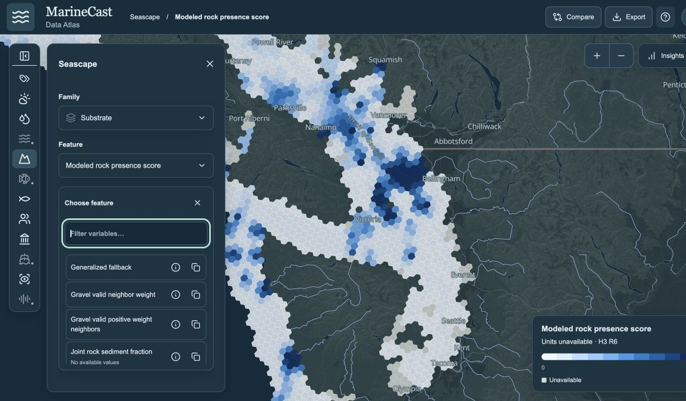
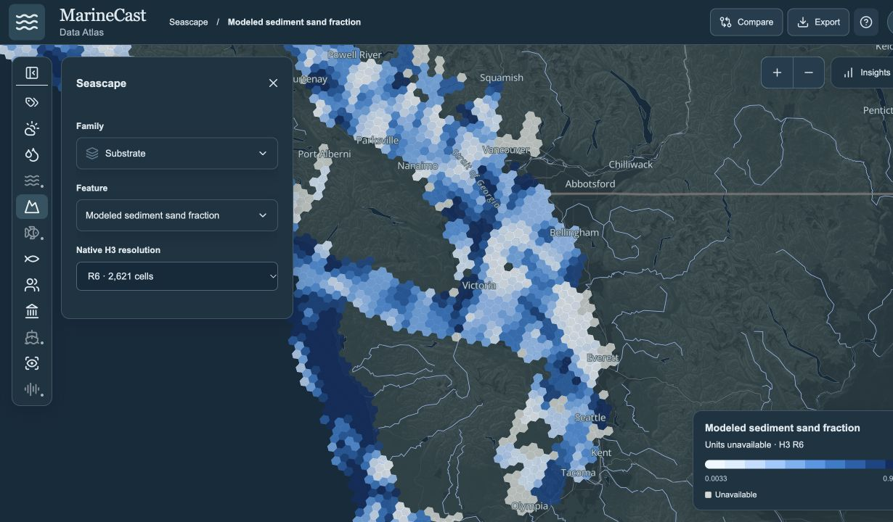

# Seascape substrate feature projection

Checked October 18, 2026 (America/New_York; equality proof recorded at 2026-10-19T00:52:54.408872+00:00).

The 15 requested fields are removed from the current prepared substrate product
and disappear from the live explorer. The toolkit delivery writer applies the
same policy to future outputs after validating native source tables. Other
substrate measurements and their scientific method are unchanged.

## Exact displayed-label mapping

| Displayed label | Prepared/native column |
| --- | --- |
| Source observation date status | `SUBSTRATE_MODEL__SOURCE_OBSERVATION_DATE_STATUS` |
| Sediment texture status | `SUBSTRATE_MODEL__SEDIMENT_TEXTURE_STATUS` |
| Sand point sample status | `SUBSTRATE_MODEL__SAND_POINT_SAMPLE_STATUS` |
| Sand mask status | `SUBSTRATE_MODEL__SAND_MASK_STATUS` |
| Rock point sample status | `SUBSTRATE_MODEL__ROCK_POINT_SAMPLE_STATUS` |
| Rock mask status | `SUBSTRATE_MODEL__ROCK_MASK_STATUS` |
| Point support status | `SUBSTRATE_MODEL__POINT_SUPPORT_STATUS` |
| Mud point sample status | `SUBSTRATE_MODEL__MUD_POINT_SAMPLE_STATUS` |
| Mud mask status | `SUBSTRATE_MODEL__MUD_MASK_STATUS` |
| H3 areal substrate coverage | `SUBSTRATE_MODEL__H3_AREAL_SUBSTRATE_COVERAGE` |
| Gravel point sample status | `SUBSTRATE_MODEL__GRAVEL_POINT_SAMPLE_STATUS` |
| Gravel mask status | `SUBSTRATE_MODEL__GRAVEL_MASK_STATUS` |
| Unsupported physical metrics reason | `SUBSTRATE_MODEL__UNSUPPORTED_PHYSICAL_METRICS_REASON` |
| Source observation period | `SUBSTRATE_MODEL__SOURCE_OBSERVATION_PERIOD` |
| Source grid degrees | `SUBSTRATE_MODEL__SOURCE_GRID_DEGREES` |

The current benthic producer also spells the sediment-texture field
`SUBSTRATE_SEDIMENT_TEXTURE_STATUS`; that exact equivalent is projected out of
the substrate area. Fields in other areas and all other substrate names remain.

## Files and contracts

- `Data/Seascape/substrate-r6-static.parquet`: 2,621 rows, **42 → 27 columns**.
- `Data/Seascape/catalog.json`: only the substrate update timestamp changes;
  stable filenames, area roster, other records and delivery schema remain.
- `Toolkits/toolkit-seascape/src/seascape/delivery_projection.py`: exact-name,
  substrate-only projection and prepared-field qualifier cleanup.
- `Toolkits/toolkit-seascape/src/seascape/domain_parquets.py`: validate each input
  before projection, then use the existing transactional writer/readback.
- `Toolkits/toolkit-seascape/tests/test_delivery_projection.py`: projection,
  scope, unchanged arrays, provenance, validation order and native schema checks.
- `Toolkits/toolkit-seascape/docs/metric-matrix.md`: canonical delivery contract.
- `Applications/applications-data-explorer/scripts/test_seascape_substrate.py`:
  stale startup encoding, refresh, exact null/value preservation and invalid-key rejection.
- `Applications/applications-data-explorer/src/pages/SeascapeSubstrate.test.tsx`:
  all 15 removed active selections fall back, and a retained feature stays usable.

No shared app implementation files were edited. The live reader's existing
catalog/Parquet checksums reject the stale optional startup encoding and build
the current checked encoding automatically. No validation was bypassed or
missing native field synthesized. Required cataloged native fields still fail
export validation before projection. The current catalog needs no checksum
schema extension: regenerated consumer bindings contain the new Parquet SHA256.

## Equality and provenance evidence

[Equality proof](seascape-substrate/equality-proof.json) records every retained
column's type, null counts and Arrow-array equality. All 27 retained arrays,
including H3 keys, equal the original projection in original row order.
Canonical Arrow IPC SHA256 is identical before and after:

`bbdbb6b018d2227d6b7839c987c90184d7938402a710d4d8e15fca1347a25c7b`

The final Parquet SHA256 is `f4748b7705c04456d480e4d9548f78037fa5b2f27ea7dc5d1f8f822be3d17841`;
the current catalog SHA256 is `3bd9dd552d9bcfa6faef159c3cd48a625435be13fbe2534eedfdeed39b9a1586`.
All 46 unrelated Seascape files (including separately keyed research) retain
their checksums; all unrelated catalog records remain unchanged. The final
delivery contains one stable substrate file, with no saved data generation.

The embedded `source_context` is structurally identical before/after (SHA256
`db88237cc25ccbb5e4495690b3f995039032d8607fb3b318732dd5825545aba4`), preserving source manifests, dictionaries,
method scope, source fingerprints, grid size and unknown observation-date
qualification. These remain provenance rather than exposed feature columns.
Other retained field definitions are preserved; references to removed feature
columns are pruned from prepared qualifier lists. Native sources are untouched.

[Current reader proof](seascape-substrate/current-reader-proof.json) verifies
all **25 non-key browser columns** against current final Parquet values/nulls,
valid qualifier bindings and the new source checksum. **33 → 18** selectable
substrate features remain. Physical hardness and joint rock/sediment fraction
remain all-null, visible as having no available values.

## Validation performed

| Check | Result |
| --- | --- |
| Focused producer/projection/domain/workflow/preflight | 96 passed |
| Full toolkit pytest suite | 590 passed, 3 expected regional-input skips |
| Projection + documentation regression checks after formatting | 20 passed |
| Reader projection/stale-startup fixture | 1 passed |
| Existing prepare-map/live-reader checks | 13 passed |
| Affected Seascape reader, page and family-picker UI tests | 76 passed |
| Final removed-selection UI cases after TypeScript correction | 15 passed |
| App TypeScript and Vite production build | Passed; existing large-chunk warnings |
| ESLint on new isolated UI test | Passed |
| Ruff lint / format across toolkit src, tests, scripts | Passed / 293 files already formatted |
| Mypy configured interfaces + new projection module | Passed, 21 + 1 files |
| Documentation checker | Passed, 64 documents / 263 local links |
| Offline production-API validation notebook | Executed successfully; source notebook untouched |
| Toolkit/app git diff --check | Passed |

The three full-suite skips concern materialized feature-catalog and network
consumer artifacts unavailable to clean offline fixtures. No full source pull,
regional acquisition or scientific rebuild was run. The notebook remains a
bathymetry client; substrate projection is covered by its dedicated regressions.

## Separate browser-tab QA

A hidden, task-owned tab used the existing localhost server without navigating
the user's tab or restarting the app. Before replacement, `Source grid degrees`
was selected. Live source refresh replaced that removed selection with the
available `Mapped bed extent in full h3 m2` layer without an error. The Substrate
picker then showed all 18 retained feature choices and none of the 15 removed
choices. `Modeled sediment sand fraction` remained selectable and rendered its
native R6 map (2,621 cells, displayed range 0.0033–0.9933). Source units were
already shown as unavailable; this task does not change that existing metadata.

## Scope, environment and cleanup

Toolkits and app already contained unrelated dirty work. No reset, staging,
commit, push, merge, source acquisition, Governance data edit or shared app
implementation edit was performed. Governance owner was notified of the exact
non-overlapping files. Messaging the original parent ID failed with thread not
found; no overlapping file edit depended on that unavailable coordination.

Python 3.14.6, PyArrow 24.0.0, Node 25.6.1, npm 11.9.0 and Ruff 0.17.1 were used.
Toolkit base HEAD: `4e5cdd0f382d52ba9f4f93cc18a4917e5347a0e7`;
app base HEAD: `9282c47eede1ff37f21201891b629234ca6407b8`.
Working-tree code hashes are recorded with the task evidence. Only task-owned
temporary tool/build/cache copies are cleaned. Reader encodings are process-owned
and cleaned on close. The writer's standard stable lock is retained; staging and
recovery backups are gone. No caffeinate process was started.

The Knowledge note was left unchanged under the requested three-tree edit scope;
the canonical toolkit delivery contract above is updated. Existing optional app
startup assets are preserved but rejected when stale; they are not the final Data
product or a fallback for changed source values.
